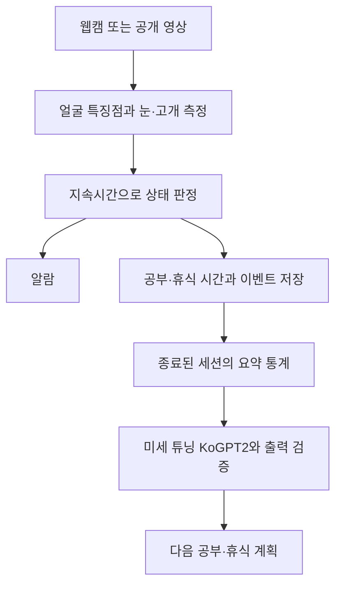

# AI 기반 학생 졸음 감지 및 LLM 맞춤형 학습 코칭 시스템

임베디드 시스템 2조의 PC·웹캠 기반 학습 보조 프로젝트입니다. 공부 중 지속적인 눈 감김과 고개 숙임을 구분해 기록하고, 세션 종료 후 미세 튜닝한 한국어 모델로 다음 공부·휴식 계획을 제안하는 것을 목표로 합니다.

먼저 **학생 1명·PC 1대·웹캠 1대에서 감지, 알림, 기록, 코칭까지 연결**합니다. 고개를 숙여 필기하는 행동은 자세 이벤트로 따로 관리합니다. 눈 감김과 공부 시간만으로 실제 수면이나 집중도를 단정하지 않습니다.

## 현재 구현 상태

2026-11-11 로컬 코드 기준입니다. 각 기능의 검증 결과와 남은 시험은 아래 문서에서 확인하며, 개별 작업의 담당·진행 상태는 [GitHub Issues](https://github.com/Saewoong0106/student-drowsiness-coach/issues)에서 관리합니다. 병합 전 브랜치의 기능은 `main`에 아직 없을 수 있습니다.

| 기능 | 구현 상태 | 남은 확인 |
|---|---|---|
| 웹캠·영상 입력, 얼굴·눈 특징점 표시 | 시제품 구현 | 사용자별 촬영 환경 시험 |
| 개인 눈 열림 보정, 지속 눈 감김 판정 | 시제품 구현 | 정답 구간과 비교한 정확도·오경보 평가 |
| 알림음, 휴식·재개, 공부·휴식 시간 계산 | 시제품 구현 | 실제 소리·키 입력과 시간 오차 대조 |
| SQLite 기록 저장·조회, JSON·CSV 내보내기 | 시제품 구현 | 현장 시나리오의 기록 누락·오차 평가 |
| Mac·Windows 실행 파일 | 준비 | Windows 실제 카메라·소리·화면 시험 |
| 고개 각도, 필기·가림 상황 구분 | 구현 예정 | 측정 모듈과 상태 판정 연결 |
| 코칭 데이터셋, KoGPT2 미세 튜닝·응답 비교 | 구현 예정 | 데이터 제작·학습·저장·재로딩·평가 |

실행 확인과 자동 검사 통과는 감지 정확도나 코칭 품질의 실측 결과와 구분합니다. [공부 세션 검증](docs/study-session-validation.md)과 [운영체제별 검증 범위](docs/cross-platform.md)를 참고하세요.

## 개발 환경과 기술 구성

| 구분 | 현재 사용 / 계획 |
|---|---|
| 실행 환경 | Python 3.11 64비트, Apple Silicon Mac / Windows 10·11 x86-64 대상 |
| 영상 입력·얼굴 측정 | OpenCV, MediaPipe Face Landmarker, NumPy |
| 화면·알림 | OpenCV 화면, Pillow 한글 표시, 운영체제별 알림음 |
| 기록 저장 | Python 기본 SQLite, JSON·CSV 내보내기 |
| LLM 학습·코칭 | KoGPT2, PyTorch, Transformers, PEFT의 LoRA 적용 계획 |
| 결과 화면 확장 | Streamlit 검토 예정 |

공통 실행 패키지는 [requirements.txt](requirements.txt), 기존 Mac 전체 설치 환경은 [requirements-macos.txt](requirements-macos.txt)에 기록합니다. 현재 설치 목록에는 LLM 학습 패키지가 포함되지 않으며, 학습 환경은 소규모 실험 후 별도로 확정합니다. Windows ARM과 Intel Mac은 별도 검증 대상입니다.

## 초기 설정

Python 3.11, Git, 웹캠 또는 노트북 카메라, 알림을 들을 스피커를 준비합니다. 패키지·얼굴 모델을 처음 내려받을 때 인터넷이 필요합니다. 각 컴퓨터에서 가상환경을 새로 만들고, 다른 사람의 `.venv`를 복사하지 않습니다.

### 1. 저장소 받기

```sh
git clone https://github.com/Saewoong0106/student-drowsiness-coach.git
cd student-drowsiness-coach
```

비공개 저장소이므로 초대받은 GitHub 계정의 접근 권한이 필요합니다. 이미 코드가 있다면 해당 프로젝트 폴더에서 진행합니다. `study_session.py`와 `requirements.txt`가 없는 경우 기능 PR의 병합 여부와 현재 브랜치를 먼저 확인합니다.

### 2. 가상환경·패키지·얼굴 모델 준비

**Mac — 터미널**

```sh
python3.11 -m venv .venv
.venv/bin/python -m pip install -r requirements.txt
.venv/bin/python -m pip check
.venv/bin/python scripts/download_model.py
.venv/bin/python study_session.py
```

**Windows — PowerShell**

Python 3.11 64비트와 Python Launcher(`py`)를 설치한 상태에서 실행합니다. `py`가 없다면 첫 명령의 `py -3.11`을 설치된 Python 3.11의 `python`으로 바꿉니다.

```powershell
py -3.11 -m venv .venv
$env:PYTHONUTF8 = "1"
.\.venv\Scripts\python.exe -m pip install -r requirements.txt
.\.venv\Scripts\python.exe -m pip check
.\.venv\Scripts\python.exe scripts/download_model.py
.\.venv\Scripts\python.exe study_session.py
```

`download_model.py`는 Google 공식 얼굴 특징점 모델을 `models/face_landmarker.task`에 저장합니다. 이 모델은 영상 측정용이며, 향후 미세 튜닝할 KoGPT2와는 별개입니다. 가상환경의 Python을 직접 호출하므로 별도 활성화 명령은 필요하지 않습니다.

최초 실행 시 실행 앱의 카메라 접근을 허용합니다. 권한 승인 직후 카메라가 열리지 않으면 다시 실행합니다. 외장 카메라는 `study_session.py --camera 1`처럼 번호를 바꿔 확인합니다. 자세한 문제 해결은 [Mac·Windows 실행 안내](docs/cross-platform.md)를 따릅니다.

### 3. 설치 후 실행

| 용도 | Mac | Windows |
|---|---|---|
| 공부 시작·눈 감김 알림·기록 | `공부_시작.command` | `start_study.bat` |
| 얼굴·눈 위치만 확인 | `카메라_시작.command` | `start_camera.bat` |
| 최근 기록 조회 | `최근_기록.command` | `recent_sessions.bat` |

실행 후 처음 10초 동안 눈을 자연스럽게 뜨고 정면을 봅니다. 보정이 끝나면 공부를 시작하고, 종료 후 최근 기록을 확인합니다. 조작 키는 카메라 창을 선택한 상태에서 누릅니다.

| 키 | 기능 |
|---|---|
| Space | 휴식 / 재개 |
| C | 눈 열림 재보정 |
| M | 알림음 켜기 / 끄기 |
| Q 또는 Esc | 기록 저장 후 종료 |

기본 기록 위치는 `data/private/study.sqlite3`입니다. Mac에서 기록을 조회·내보내는 명령은 다음과 같습니다. Windows에서는 `.venv/bin/python`을 `.\.venv\Scripts\python.exe`로 바꿉니다.

```sh
.venv/bin/python session_report.py --list
.venv/bin/python session_report.py --export data/private/export
```

내보내기 결과는 세션 요약 JSON과 이벤트 CSV입니다. 공부 시간은 보정·휴식을 제외한 경과 시간이며, 얼굴을 관측하지 못한 시간을 함께 표시합니다. 자세한 사용법은 [공부 세션 안내](docs/study-session.md)를 참고하세요.

## 구현 방향

영상 측정, 시간에 따른 상태 판정, 기록, 한국어 코칭을 분리해 개발합니다. MediaPipe는 얼굴 특징점을 찾고, Python은 눈 열림·고개 각도와 지속시간을 계산합니다. LLM에는 영상 대신 종료된 세션의 요약 통계와 세션 ID를 전달합니다.



고개 측정과 LLM 코칭을 포함한 **최종 목표 구조**입니다. 코칭 생성은 영상 처리와 별도 작업으로 실행해 카메라 감지를 막지 않도록 합니다. 모듈 연결 규칙은 [모듈 간 약속](docs/interfaces.md)에 정리합니다.

### 단계별 개발 순서

| 단계 | 작업 | 완료 기준 |
|---|---|---|
| 1. 입력·측정 | 웹캠·공개 영상 입력, 특징점과 눈 열림 측정 | 영상과 측정값 확인, 얼굴 미검출 처리 |
| 2. 판정·알림·기록 | 개인 보정, 눈 감김 지속시간 판정, 알림, 시간 계산, SQLite 저장 | 깜박임 제외, 휴식·재개·종료, 저장·조회 연결 |
| 3. 자세·가림 구분과 감지 평가 | 상대 고개 각도 측정, 필기·눈 감김·측정 불가 구분, 정답 구간 작성 | 유형별 정밀도·재현율·F1과 오경보·알람 지연 측정 |
| 4. LLM 학습 | 통계·한국어 코칭 문장 쌍 제작, KoGPT2에 LoRA 우선 시험 | 실제 학습 로그, 모델 저장·재로딩, 기본 모델과 응답 비교 |
| 5. 통합·시연 | 기록 조회·코칭 화면 연결, 실패 표시, 운영체제별 실행 검증 | 전체 흐름 반복 성공, 연속 실행 시험, 보고서·시연 영상 준비 |

현재 1·2단계의 시제품과 운영체제별 실행 파일을 준비한 상태입니다. 다음에는 실제 환경 검증과 자세·가림 구분을 진행하고, 코칭 데이터 제작·소규모 학습은 담당자가 병행합니다. 상세 일정과 개별 작업은 [구현 계획](docs/implementation-plan.md), [초기 작업 목록](docs/backlog.md), GitHub Issues에서 관리합니다.

### 감지와 코칭의 출발 기준

- **눈 감김:** 보정한 눈 열림의 65% 미만이 2초 지속되면 의심 이벤트와 알림을 생성합니다. 75% 이상이 1초 유지되면 회복 처리합니다. 현재 코드의 초기 설정입니다.
- **고개 숙임:** 기준 자세보다 아래로 20도 이상 숙인 상태가 3초 지속되면 자세 이벤트로 기록하는 것을 목표로 합니다. 아직 구현 전입니다.
- **측정 불가:** 얼굴 미검출이나 입력 공백은 눈 감김으로 세지 않습니다. 손 가림·안경 반사·역광은 추가 검증이 필요합니다.
- **코칭 데이터:** 8가지 상황의 가상 통계와 검토된 코칭 문장 약 800쌍을 목표로 합니다. 학습·검증·시험은 640·80·80건을 목표로 하되, 표현이나 수치만 바꾼 같은 원형 사례는 같은 그룹에 둡니다.
- **모델 비교:** 기본 KoGPT2, 실제 미세 튜닝 모델, 규칙 안내에 동일한 시험 입력을 적용합니다. 공개 영상은 감지 개발·평가용이며, LLM 학습에는 별도의 통계·문장 쌍을 사용합니다.

임계값과 데이터 수량은 개발 시작안이며 검증 후 확정합니다. 최종 시험 전에 설정과 데이터 분할을 고정합니다. 학습·출력 검증의 상세 기준은 [구현 계획](docs/implementation-plan.md)을 따릅니다.

## 평가 목표와 최종 산출물

계획서·중간발표에서 정한 만족 기준입니다. **아래 수치는 목표이며, 아직 달성한 실측 성능이 아닙니다.**

| 평가 항목 | 목표 |
|---|---|
| 눈 감김·고개 숙임 감지 | 두 유형 각각 F1 ≥ 0.85, 정상 관측 오경보 ≤ 2회/시간 |
| 실시간 처리·알람 | 지정 PC 평균 ≥ 10 FPS, 알람 지연 P95 ≤ 1초 |
| 시간·기록 | 10분 시험 최대 시간 오차 ≤ 2초, 필수 이벤트 누락 0건 |
| LLM 코칭 | 미세 튜닝 증빙, 품질 ≥ 4.0/5, 수치 일치율 ≥ 95%, 기본 모델보다 품질 개선 |
| 통합 시연 | 감지·알림·기록 조회·미세 튜닝 코칭 5회 연속 성공, 30분 연속 실행 중 중단 없음 |

알람 지연은 눈 감김을 시작한 순간이 아닌 **지속시간 조건을 충족한 시점**부터 측정합니다. 최종 제출물은 실행 프로그램·소스코드, 설치·실행 매뉴얼, 검토된 코칭 데이터와 분할 명세, 학습 설정·로그와 모델 가중치, 평가 원자료, 최종 보고서·발표자료·시연 영상입니다. 큰 모델 파일과 개인 원자료는 Git 저장소 외의 전달 방법을 정합니다.

PC에서 기본 기능을 검증한 뒤 라즈베리파이 등 별도 보드 이식을 검토합니다. 여러 학생 동시 감지와 자동 이슈 처리 AI도 기본 완료 범위 이후의 확장입니다.

## 팀 역할과 협업

발표자료의 역할 분담안입니다. 실제 담당은 팀에서 확인하고 각 이슈의 Assignee로 관리합니다.

| 담당 | 책임 범위 |
|---|---|
| 김수현 | 프로젝트 총괄, 일정·시연 운영, SQLite 기록 저장과 화면 |
| 김수연 | 공개 영상 준비, 얼굴 특징점, 눈 열림·고개 각도 보정, 정답 구간 표기 |
| 김건효 | 코칭 데이터 제작, KoGPT2 미세 튜닝, 모델 전후 품질 비교 |
| 강세웅 | 졸음·자세 판정, 알람, 모듈 연결, 통합 검증, 최종 병합 |

이슈 작성 → 작업 브랜치 → 구현·검증 → PR → 리뷰·병합 순서로 진행합니다. 강세웅이 작성한 PR은 다른 팀원의 검토를 받습니다. 작업 시작·결과 공유와 병합 절차는 [협업 방법](CONTRIBUTING.md)을 따릅니다.

### 현재 코드 구성

| 경로 | 역할 |
|---|---|
| `study_session.py` | 공부 세션 실행, 카메라·영상 입력과 모듈 연결 |
| `camera_preview.py` | 얼굴·눈 특징점 미리보기 |
| `session_report.py` | 저장 기록 조회, JSON·CSV 내보내기 |
| `study_coach/eyes.py` | 눈 열림 측정 |
| `study_coach/session.py` | 보정, 시간·상태 판정, 세션 집계 |
| `study_coach/alarm.py` | 운영체제별 알림음 |
| `study_coach/storage.py` | SQLite 저장·조회 |
| `study_coach/view.py` | 카메라 화면·상태 표시 |
| `scripts/download_model.py` | 공식 얼굴 특징점 모델 다운로드 |
| `tests/`, `docs/` | 자동 검사, 사용·설계·검증 문서 |

`src/study_coach/` 등 초기 계획의 폴더는 향후 정리안이며 현재 실행 경로는 위 표를 기준으로 합니다. 고개 측정·코칭 모듈은 연결 규칙을 확인한 뒤 추가합니다.

## 데이터 관리

실사용 얼굴 영상은 기본적으로 저장하지 않고 PC에서 처리합니다. 실제 공부 기록은 `data/private/`, 내려받은 모델은 `models/`에 두며 Git에서 제외합니다. 원본 얼굴 영상, 개인 세션, 모델 가중치, 비밀키와 `.venv`는 GitHub에 올리지 않습니다. 공유할 데이터에는 출처·이용 조건·다운로드 방법을 기록하고, 평가용 영상은 참여 동의를 받은 필요한 구간만 수집합니다.

## 상세 안내

| 자료 | 내용 |
|---|---|
| [Mac·Windows 실행](docs/cross-platform.md) | 설치, 운영체제별 차이, 문제 해결과 검증 범위 |
| [공부 세션 안내](docs/study-session.md) | 보정·알림·휴식, 기록 해석과 내보내기 |
| [공부 세션 검증](docs/study-session-validation.md) | 시제품 확인 결과와 남은 수동 시험 |
| [첫 실행 안내](docs/first-run.md) | 얼굴·눈 위치 미리보기 사용법 |
| [데이터 조사](docs/datasets.md) | 공개 영상의 용도, 접근 방법과 한계 |
| [구현 계획](docs/implementation-plan.md) | 단계별 설계, 일정, 모델 학습과 완료 기준 |
| [모듈 간 약속](docs/interfaces.md) | 측정·판정·저장·코칭의 입력·출력 |
| [초기 작업 목록](docs/backlog.md) | 작업 분할과 선행 관계 |
| [협업 방법](CONTRIBUTING.md) | 이슈·브랜치·PR과 리뷰·병합 절차 |
| [학습 안내](docs/learning-guide.md) | 구현 원리, 연습 문제와 점검 항목 |
