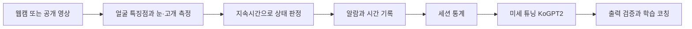

# 학생 졸음 감지와 학습 코칭

임베디드 시스템 2조의 PC·웹캠 기반 학습 보조 프로젝트입니다. 눈 감김과 고개 숙임을 구분해 기록하고, 공부가 끝나면 미세 튜닝한 한국어 모델로 다음 학습·휴식 계획을 제안합니다.

현재 **얼굴·눈 위치를 표시하는 첫 카메라 시제품**을 준비했습니다. [첫 실행 안내](docs/first-run.md)에 따라 `카메라_시작.command`를 실행할 수 있습니다. 아직 졸음 판정·알람·고개 각도·기록·LLM은 구현 전입니다. 계획의 성능 수치는 목표이며 실측 결과가 아닙니다.

## 먼저 읽을 자료

| 자료 | 내용 |
|---|---|
| [첫 실행 안내](docs/first-run.md) | 카메라 실행, 오늘의 확인 항목, 문제 해결 |
| [데이터 조사](docs/datasets.md) | 공개 데이터의 실제 용도, 접근 방법, 촬영 대체 범위 |
| [구현 계획](docs/implementation-plan.md) | 맥북 개발 순서, 일정, 담당, 완료 기준 |
| [모듈 간 약속](docs/interfaces.md) | 서로 다른 팀원의 코드를 연결할 입력·출력 규칙 |
| [초기 작업 목록](docs/backlog.md) | 이슈로 나눌 작업과 선행 작업 |
| [협업 방법](CONTRIBUTING.md) | 이슈 → 브랜치 → PR → 세웅 검토·병합 |
| [학습 안내](docs/learning-guide.md) | 5단계 설명, 연습 문제, 점검 문제와 작은 프로젝트 |

## 역할 제안

발표자료의 역할을 출발점으로 삼으며 실제 배정은 팀에서 확인합니다. GitHub 아이디가 확인되면 각 이슈의 Assignee를 지정합니다.

| 담당 | 책임 범위 | 예정 작업 폴더 |
|---|---|---|
| 김수현 | 일정, SQLite 기록, 화면 | `src/study_coach/storage/`, `src/study_coach/ui/` |
| 김수연 | 공개 영상 준비, 얼굴 특징점, EAR·고개 각도 | `src/study_coach/vision/`, `data/manifests/` |
| 김건효 | 코칭 데이터, KoGPT2 미세 튜닝, 모델 비교 | `src/study_coach/coaching/`, `training/` |
| 강세웅 | 상태 판정, 알람, 연결 규칙, 통합 검증, 최종 병합 | `src/study_coach/detection/`, `tests/`, `evaluation/` |

위 코드 폴더는 향후 구현 위치입니다. 빈 파일로 기능 완료를 표시하지 않습니다.

## 전체 흐름

영상 감지는 이미 학습된 MediaPipe를 사용합니다. 공개 영상은 감지 규칙 개발·평가에 쓰며, KoGPT2 학습에는 별도의 **학습 통계와 한국어 코칭 문장 쌍**이 필요합니다.

## 완료 범위

- 1명·웹캠 1대로 눈 감김, 고개 숙임, 측정 불가를 구분한다.
- 시작·휴식·재개·종료, 알람, 이벤트 기록·조회가 동작한다.
- 실제 미세 튜닝 모델을 저장·재로딩하고 코칭을 생성한다.
- 기본 모델·미세 튜닝 모델·규칙 안내를 같은 입력으로 비교한다.
- 감지 평가 원자료, 실행 환경, 시연 영상을 남긴다.

라즈베리파이 이식, 여러 학생 동시 감지, 자동 이슈 처리 AI는 기본 기능 완성 이후의 확장입니다.

원본 얼굴 영상, 실제 학습 세션, 모델 가중치, 비밀키는 GitHub에 올리지 않습니다. 출처·다운로드 방법·데이터 목록만 공유합니다.
